<div align="center">



[](https://git.io/typing-svg)

<br/>

[](https://www.linkedin.com/in/suhaili-faruq-8475a0189/)
[](mailto:suhaili.faruq01@gmail.com)
[](https://portfolioweb-55f91.web.app/)

</div>

---

# // 01 :: About

```dart
class Developer {
  final String name = "Suhaili Faruq";
  final String role = "Mobile FullStack Engineer";
  final String location = "Jakarta, Indonesia";
  final int yearsOfExperience = 4+;

  // All three stacks have apps in production.
  final List<String> mobile = [
    "Flutter (Riverpod, BLoC)",
    "Kotlin (Native Android, Compose, KMP)",
    "React Native (bare 0.87, Nitro modules, Re.Pack)",
  ];

  // Personal projects, freelance work, and the Go services at Reddog.
  final List<String> backend = [
    "Go (Fiber v3, Gin, gRPC)",
    "Kotlin (Ktor)",
    "PostgreSQL",
    "Redis",
    "Docker, Nginx, VPS",
  ];

  // Planning, implementation, testing, and debugging.
  final String aiAssistant = "Claude Code";

  final String focus =
      "Offline-first mobile apps with reliable data sync, "
      "backed by REST services I can build and deploy myself.";

  final int appsPublished = 7; // Play Store + App Store

  String mindset() => "Build clean. Build scalable. Keep learning.";
}
```

I have built mobile apps for four years: mall loyalty programs, city government tax
services, network operations tools, batik e-commerce, heavy equipment field inspection,
and now food ordering.

Most of those apps had to work offline. Field users kept recording data without a signal,
and I built the sync layer that reconciled it later, on Realm, Room, and SQLite. I have
production apps in Flutter, Kotlin, and React Native, and I pick the stack that fits the
project.

I also build the services my apps call. I write them in Go Fiber or Ktor with PostgreSQL
and Redis, then deploy them to a VPS I maintain. Owning both sides lets me shape an API
around how the app reads and writes its data.

---

# // 02 :: Current Role · Reddog

<sub><code>[ MOBILE ENGINEER · PRIVATE REPOSITORIES · APPS IN INTERNAL TESTING ]</code></sub>

<div align="center">


</div>

<br/>

Reddog runs a food ordering platform. Customers order from outlets in the customer app,
outlet staff handle incoming orders in the outlet app, and admins manage menus, vouchers,
payments, and staff in a web backoffice. I work across all three apps and the Go backend
behind them.

| Repository | Description | Stack | Source |
|---|---|---|---|
| **reddog-application** | Nx monorepo with the customer app, outlet staff app, and admin backoffice on one shared API and auth layer | React Native 0.87 (bare), React 19, Vite, TanStack Router + Query, zod, Nitro native modules | [repo](https://github.com/Reddog-Technology-Team/reddog-application) `private` |
| **reddog-backend** | Seven gRPC services behind a REST gateway. Writes go through an outbox to Kafka, and reads come from Elasticsearch projections | Go 1.27, gRPC + buf, Gin, PostgreSQL, Kafka, Elasticsearch, Redis, OpenTelemetry | [repo](https://github.com/Reddog-Technology-Team/reddog-backend) `private` |

What I have shipped so far:

- **Force update**: I added the update screen to the customer and outlet apps, plus the version config endpoint in the gateway that drives it.
- **Voucher validation**: I re-check vouchers at checkout and again at charge, measure minimum spend before tax, block sends of expired vouchers, and settle zero-total checkouts.
- **Access control**: I limited role and admin changes to superadmins in the gateway and the backoffice, and hid backoffice actions from users without the matching permission.
- **Safe deletion**: I blocked deactivating staff or outlets with orders in progress, then added permanent outlet deletion and soft-deleted staff.
- **Order state**: the apps now refresh order status and outlet hours on screen focus and pause queries for screens out of view. Outlet stats reset at midnight WIB.
- **Platform fixes**: iOS deep links into a running app, edge-to-edge safe areas, keyboard overlap in bottom sheets, and Rupiah decimals.

Both mobile apps are in internal testing ahead of the store release.

---

# // 03 :: Personal Project · Shop POS

<sub><code>[ FULL STACK · FRONTEND + BACKEND · PUBLIC REPOSITORIES · BUILT WITH CLAUDE CODE ]</code></sub>

<div align="center">


</div>

<br/>

I designed and built Shop POS, a point-of-sale system for small shops and warungs, from
the database to the cashier's screen. Owners run the business from a web CMS. Staff record
sales in a cashier app that keeps working when the internet drops. Both apps call one Go
API that I deploy and maintain, so the three parts ship as one system.

| Repository | Role in the system | Stack | Source |
|---|---|---|---|
| **POS_project_FE** | Flutter monorepo with the web CMS for the owner and the offline-first Android/iOS cashier app, on one shared core package | Flutter, Dart 3, Melos + pub workspace, BLoC, go_router, get_it, dio, drift, freezed, FCM | [repo](https://github.com/FaaStatic/POS_project_FE) |
| **POS_System_Project_BE** | REST API for products, categories, customers, staff, sales, debts, payments, the dashboard, and reports | Go 1.26, Fiber v3, GORM + PostgreSQL, Redis, goose, Cobra, Viper, Midtrans, fpdf, excelize, Swagger | [repo](https://github.com/FaaStatic/POS_System_Project_BE) |

```text
Architecture overview
────────────────────────────────────────────────────────────────────────────
 CMS (Flutter web)  ─┐                            ┌─► PostgreSQL  stock, sales, debts
                     ├─► REST /api ─► Go Fiber v3 ┼─► Redis       sessions
 Cashier (Android/iOS)   JWT + role    │          └─► Midtrans    QRIS / VA
   │                                   │                 │
   │                                   └◄── webhook ─────┘ ─► FCM push to cashier
   └─ drift: product cache + offline sale queue ─► POST /api/transactions/sync
────────────────────────────────────────────────────────────────────────────
```

**Frontend · POS_project_FE**

- **Architecture**: I split each feature into domain, data, and presentation layers. Blocs call only use cases, and each use case returns a sealed `Result` (`Ok` or `Err(Failure)`). Both apps import a shared `core` package; the web build skips the mobile entry point, which keeps drift and secure storage out of the bundle.
- **Offline cashier**: the app caches products, categories, and customers in drift. When a cashier sells for cash or on credit with no connection, the app issues an `OFF-` receipt number, lowers local stock, and queues the sale. It sends the queue in batches of 100 when the connection returns, at 12:00 and 00:00 through workmanager, or when the cashier taps sync.
- **Parallel sales**: cashiers keep several sales open at once. The app locks a sale while it waits for QRIS or VA, and an FCM push tells it when the payment settles.
- **Owner CMS**: dashboard with trends, transaction review, debt tracking, bulk product import from Excel or CSV, staff and device management, and monthly PDF reports.
- **Quality**: the coverage check fails when the domain, data, or bloc layers drop below 80%.

**Backend · POS_System_Project_BE**

- **Architecture**: I layered the API as `delivery/http` → `usecase` → `repository` → `domain`, with a Cobra CLI for `serve`, `migrate`, `migrate-reset`, and `create-admin`. Goose runs the migrations, and Viper loads a config file per environment.
- **Auth and roles**: JWT access tokens with sessions in Redis. The API separates staff from superadmin, and deactivating a staff member revokes their sessions and push tokens at once.
- **Atomic sales**: one database transaction changes stock and debt together. The API locks product rows `FOR UPDATE` in ID order to avoid deadlocks and retries serialization conflicts with backoff. A concurrency test covers the stock reservation.
- **Offline sync endpoint**: `POST /api/transactions/sync` takes up to 100 sales per request and settles each one on its own. A `client_ref` on each sale stops a resent queue from recording twice, and a `retryable` flag tells the app whether to send it again. When server stock runs short, the API keeps the sale, stops stock at 0, and flags a `stock_conflict` for the owner.
- **Business rules**: selling price must exceed purchase price, and the credit price must be at least 105% of the selling price, checked in the use case and by a database constraint. Each customer holds at most one open debt, and installments carry an `idempotency_key`. Staff can cancel only their own sales from the same day, with a reason.
- **Payments**: Midtrans QRIS and VA (BCA, Mandiri). The server prices every item and adds the fee (0.7% for QRIS, flat for VA), then verifies each webhook signature before it updates the sale.
- **Reports and data**: monthly sales and debt PDFs with fpdf, product import from Excel or CSV with excelize, and a dashboard query covering revenue, gross profit, debt, top products, and payment mix over up to 366 days. Swagger documents every endpoint.
- **Deployment**: Docker Compose with per-environment secrets, behind Nginx on a Linux VPS.

**How the two halves fit**: the cashier and the API share one contract. The app's validators
mirror the backend rules for barcodes, SKUs, and passwords; the web CMS refreshes its token
through an HttpOnly cookie while the mobile app keeps it in secure storage; and the offline
queue and the sync endpoint agree on `client_ref`, per-item results, and stock conflicts.

---

# // 04 :: Published Apps

<sub><code>[ ORDERED BY RECENCY ]</code></sub>

Seven of my apps are live on the Play Store and App Store. COIP, an enterprise app for
United Tractors, reaches its users through enterprise distribution. I will add Reddog's
two apps once they leave internal testing.

| App | Platform | Stack | Source |
|---|---|---|---|
| **COIP Mobile** (United Tractors) \* | Android, iOS | React Native 0.74, Realm, TanStack Query, Zustand | [repo](https://github.com/FaaStatic/project_coip) `private` |
| **ForYou** (Sinarmas Land) | Android, iOS | Flutter, Riverpod, Clean Architecture | [repo](https://github.com/FaaStatic/foryou-sinarmasland-source) |
| **MyKekancan** | Android, iOS | Flutter, Riverpod, Google Maps | [repo](https://github.com/FaaStatic/myKekancan-app-source) |
| **NMSxPro Mobile** | Android, iOS | Flutter, BLoC, on-device SSH client | [repo](https://github.com/FaaStatic/nmsmobile-source) |
| **Nexa Ticket Scanner** | Android | Flutter, barcode / QR scanning | `private` |
| **Hebat!** (Semarang City Gov) | Android, iOS | React Native, Redux Toolkit | [repo](https://github.com/FaaStatic/hebat-apps-source) |
| **Kla Computer** (Infokom) | Android, iOS | React Native, Redux Toolkit, FCM | [repo](https://github.com/FaaStatic/infokom-mobile-source) |
| **Naratik** (Batik e-commerce) | Android | Kotlin, Hilt, Room, WorkManager, CNN model | [repo](https://github.com/FaaStatic/naratik-mobile-source) |

<sub>\* United Tractors distributes COIP Mobile to its customers as an enterprise app. The other seven are on the public stores. <code>private</code> marks closed client source; people with access can open the link.</sub>

---

# // 05 :: Mobile

### ▚ Flutter

<sub><code>[ 4 PUBLISHED APPS · 2022 TO 2024 ]</code></sub>

<div align="center">

<br/><br/>


</div>

I built four of the seven published apps in Flutter, for loyalty, maps, and network
operations. NMSxPro ships an on-device SSH client, so field technicians run commands on
network equipment from their phones. ForYou and MyKekancan use Riverpod 2 with Clean
Architecture, and NMSxPro uses BLoC. On Shop POS (// 03) I run BLoC and Clean
Architecture across two apps in one monorepo.

### ▚ Kotlin

<sub><code>[ NATIVE ANDROID SINCE 2021 · KOTLIN MULTIPLATFORM ]</code></sub>

<div align="center">

<br/><br/>


</div>

I started on native Android and still reach for it when a project needs the platform
directly. I built Naratik in Kotlin with Hilt, Room, DataStore, and WorkManager background
sync. Its batik authenticity checker runs the CNN model from a paper I co-authored. KMP
Todo shares domain models between Android and iOS Compose clients and a Ktor backend, all
in Kotlin.

### ▚ React Native

<sub><code>[ 2 PUBLISHED APPS · COIP · REDDOG IN TESTING ]</code></sub>

<div align="center">

<br/><br/>


</div>

I built Hebat! for the Semarang city government and Kla Computer for Infokom with Redux
Toolkit. At PT United Tractors Tbk I built COIP Mobile and generated its typed API layer
from the backend OpenAPI spec with Kubb. The team wrote no client code by hand, and the
client stayed in step with the schema. COIP validates more than 100 conditional fields
across multi-tab checksheets, and I covered it with about 100 unit and UI tests in Jest
and RNTL. At Reddog I work in bare React Native 0.87 with Nitro native modules, where two
apps share one UI library in an Nx monorepo.

### ▚ Offline-first

I have built offline sync on four storage layers: Realm on COIP, Room with WorkManager on
Naratik, drift on the Shop POS cashier, and SQLite elsewhere. Field users create records
and take photos with no signal, and the app reconciles them when the connection comes
back. On Shop POS, cashiers keep selling for cash or credit through an outage. The app
syncs those sales in batches when the device reconnects or at the noon and midnight runs.

---

# // 06 :: Backend

<div align="center">

<br/><br/>


</div>

| Project | Description | Stack |
|---|---|---|
| [**Shop POS Backend**](https://github.com/FaaStatic/POS_System_Project_BE) | The API behind Shop POS (// 03): atomic sales, offline sync, debt tracking, Midtrans payments, and PDF reports, on a Linux VPS. | Go Fiber v3, GORM, PostgreSQL, Redis, Cobra CLI migrations |
| [**KMP Todo**](https://github.com/FaaStatic/kmp_todo_app) | Full-stack Kotlin: a Compose Multiplatform client that shares domain models with a Ktor backend, with JWT refresh tokens, BCrypt, and Swagger. | Kotlin Multiplatform, Ktor, Exposed, PostgreSQL |
| [**Local CDN**](https://github.com/FaaStatic/local_cdn_go) | A small Go server that hands Re.Pack bundles to React Native clients during development. | Go |
| [**LMS Inkaedu**](https://github.com/FaaStatic/web-lms-inkaedu-source) | Learning platform for AMDAL certification training. I deployed the frontend and backend to production, with 100 active users at launch. | React 18, Redux Toolkit |

I built most of these as personal or freelance projects. At Reddog I also contribute to the
Go gateway and services (// 02). Because I write the server side too, I design the API
contract with the client in mind. On COIP I generated the client from the OpenAPI spec, so
the schema was the contract. On KMP Todo the client and server share domain models in one
language. I run the Shop POS backend in production myself, with Docker Compose, Nginx, and
Certbot for TLS.

Mobile is my main focus. With a backend team, I can read their code, propose endpoint
shapes, and debug an integration from both ends.

---

# // 07 :: More Projects

<sub><code>[ TECHNICAL TESTS · LABS · ARCHITECTURE STUDIES ]</code></sub>

| Project | What it shows | Stack |
|---|---|---|
| [**CineBrowse**](https://github.com/FaaStatic/CineBrowse) | Movie browser with offline favorites, infinite scroll, and theme switching, split into UI, domain, and data layers with unit tests for ViewModels, PagingSources, and repositories. | Kotlin, Jetpack Compose, MVVM, Hilt, Retrofit, Room, Paging 3, DataStore, MockK |
| [**TBP Posko Map**](https://github.com/FaaStatic/TBPMapsTask) | Take-home test: a map screen driven by a four-state machine (start, option, list, card) for browsing public facility locations, with Clean Architecture layers. | React Native 0.81 (bare, New Architecture), TypeScript strict, Zustand, TanStack Query, Zod, react-native-maps, MMKV, NativeWind |
| [**Expo + Re.Pack Super App**](https://github.com/FaaStatic/expo-repack) | Module Federation setup with one host app loading two mini apps and a shared module at runtime. | Expo, Re.Pack, Module Federation, pnpm workspaces, Turborepo |
| [**VoIP Demo**](https://github.com/FaaStatic/voipappdemo) | Voice calling over WebRTC with phone number and OTP sign-in, push notifications for incoming calls, and feature-first folders. | Flutter, Riverpod (codegen), flutter_webrtc, Firebase Auth, FCM, go_router, dio |
| [**QR Payment Scanner**](https://github.com/FaaStatic/project-barcode-scan-compose-source) | Technical test: scans payment QR codes with the camera, records payments, and keeps a local history. | Kotlin, Jetpack Compose, CameraX, ML Kit Barcode, Hilt, Room, DataStore |
| [**GameInfo**](https://github.com/FaaStatic/MySimpleGameInfoApp) | Game catalog split into a core module and a dynamic feature module for favorites, with CI on CircleCI. | Kotlin, Flow, Dagger Hilt, Retrofit, Room, Lottie, Dynamic Feature Modules |

---

# // 08 :: AI-Assisted Development

<div align="center">


</div>

<br/>

I use Claude Code as an AI assistant and agent across the whole cycle. I plan changes with
it, have it implement features against tests, run the checks, and trace bugs to their root
cause. I built Shop POS this way, from feature plans to the fixes after device testing, and
I work through Reddog bug tickets the same way.

```text
Development workflow
──────────────────────────────────────────────────────────────────────
[01] PLAN    review the codebase, outline the change, list affected files
[02] BUILD   write a failing test, implement the minimum code, refactor
[03] TEST    static analysis, unit and widget tests, coverage check
[04] DEBUG   reproduce the issue, find the root cause, fix it at the source
──────────────────────────────────────────────────────────────────────
```

I keep a `CLAUDE.md` in each repository with its architecture rules, folder structure, and
commands, so the agent follows the project's conventions. Through Context7 I pull docs for
the exact library versions in the lockfile. I also set hooks that make the agent state a
purpose before it runs a shell command or creates a file.

---

# // 09 :: Publication

**Classification of Batik Authenticity Using Convolutional Neural Network Algorithm with Transfer Learning Method**
2021 Sixth International Conference on Informatics and Computing (ICIC), IEEE, Nov 2021, pp. 1 to 6.
[DOI: 10.1109/ICIC54025.2021.9632937](https://doi.org/10.1109/ICIC54025.2021.9632937)

The Naratik Android app uses the model from this paper for its authenticity checker.

---

# // 10 :: Current Focus

```yaml
Mobile:
  - Flutter: Riverpod, BLoC, Clean Architecture
  - Kotlin: Compose, KMP, Hilt
  - React Native: bare 0.87, Nitro modules, Re.Pack + Rspack

Architecture:
  - Clean Architecture
  - MVVM
  - Offline-first sync (Realm, Room, SQLite, drift)
  - Nx and Melos monorepos, Module Federation

Backend:
  - Go: Fiber v3, Gin, gRPC
  - PostgreSQL, Redis, Kafka, Elasticsearch
  - Docker, Nginx, CI/CD

AI Workflow:
  - Claude Code: planning, implementation, testing, debugging
  - CLAUDE.md project rules, MCP (Context7), hooks
```

---

<details>
<summary><b>// Archive</b> (earlier and smaller projects)</summary>

<br/>

**Flutter**
- [Survey Apps](https://github.com/FaaStatic/project-survey-app-source) - survey app
- [Money Expense Tracker](https://github.com/FaaStatic/moneyexpensetracker) - expense tracking
- [Payment App](https://github.com/FaaStatic/proyek-money-tracker-source) - Riverpod, dio, workmanager
- [Boilerlib](https://github.com/FaaStatic/boilerlibflutter) - reusable starter: dio interceptors, route guards, camera, permissions
- [Portfolio Web](https://github.com/FaaStatic/portfolioapps) - Flutter Web

**Android (Kotlin)**
- [Movie Catalogue](https://github.com/FaaStatic/MovieCatalogue) - Retrofit, Room, Paging, unit and UI tests
- [Rent Game](https://github.com/FaaStatic/proyek-rental-game-ui-source) - my first Jetpack Compose app, Room, Coil
- [Github Apps](https://github.com/FaaStatic/GithubApp) - GitHub user search with Retrofit
- [Kotawaringin Tourist](https://github.com/FaaStatic/KotawaringinaratTouristApp) - tourist spots in Kotawaringin Barat

**React Native and web**
- [Semargress 2022](https://github.com/FaaStatic/semargress2022-source) - React Native
- [RN Maps](https://github.com/FaaStatic/reactNativeMapsApps) - React Native with Google Maps
- [Employee CRUD](https://github.com/FaaStatic/Project_react_native_crud_empoyee) - Expo, React Navigation, React Native Paper
- [ChatGPT UI Clone](https://github.com/FaaStatic/clone_chatgpt_codecrusade) - React, Vite, TanStack Router + Query + Form, Radix UI, Tailwind

**Other**
- [Cashier Bookstore](https://github.com/FaaStatic/project-cashier-book-source) - Java Swing
- [Village Admin System](https://github.com/FaaStatic/proyek-sistem-desa-source) - CodeIgniter 4

</details>

---

# // 11 :: GitHub Activity

<div align="center">

<br/><br/>
<picture>
  <source media="(prefers-color-scheme: dark)" srcset="./profile/snake-dark.svg" />
  <source media="(prefers-color-scheme: light)" srcset="./profile/snake-light.svg" />
  
</picture>
</div>

---

# // 12 :: Contact

<div align="center">

<a href="https://www.linkedin.com/in/suhaili-faruq-8475a0189/">
  
</a>
<a href="mailto:suhaili.faruq01@gmail.com">
  
</a>
<a href="https://portfolioweb-55f91.web.app/">
  
</a>

<br/><br/>


</div>
